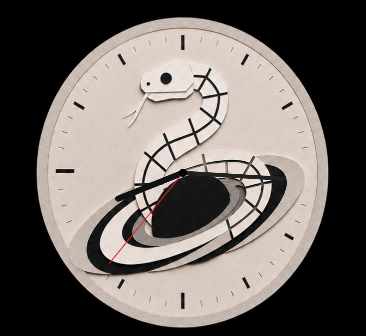
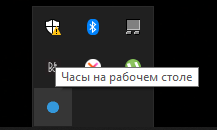
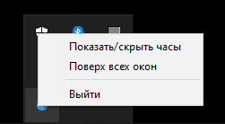
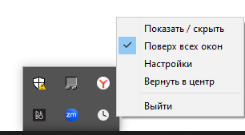
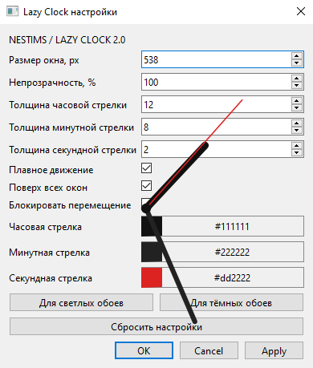

# Lazy Clock

> A minimal desktop clock – always visible, always movable.

| Project Information | Details |
|---|---|
| Project ID | NS-011 |
| Direction | Infotech |
| Development Phase | Phase II |
| Version | v2.0 |
| Platform | Windows / Python |
| Status | Completed |

> 

## 📖 Overview

A floating analog desktop clock with a transparent background, customizable appearance and system tray controls.

## ✨ Features

- Movable frameless clock with optional always-on-top mode

- Adjustable size and opacity

- Custom hand colors and widths

- Smooth or stepped second hand

- Position locking and persistent settings

- System tray controls

## 🛠 Technology Stack

- Python
- PySide6
- QSettings

## 📦 Installation

- Download EXE from Releases: [more...](https://github.com/NebulaStack-prog/Lazy-Clock/releases/tag/v2.0)

- Or run with Python: [more...](Lazy_Clock-New.py)

- Original source code (Old): [more...](Lazy_Clock.py)

## 📄 Documentation

- Russian documentation: [more...](Lazy_Clock_RU.md)

- English documentation: [more...](Lazy_Clock_EN.md)

## 📊 Project Status

A completed NESTIMS Phase II project. Both the original and updated Python implementations are preserved.

## 📷 Screenshots

© NESTIMS
